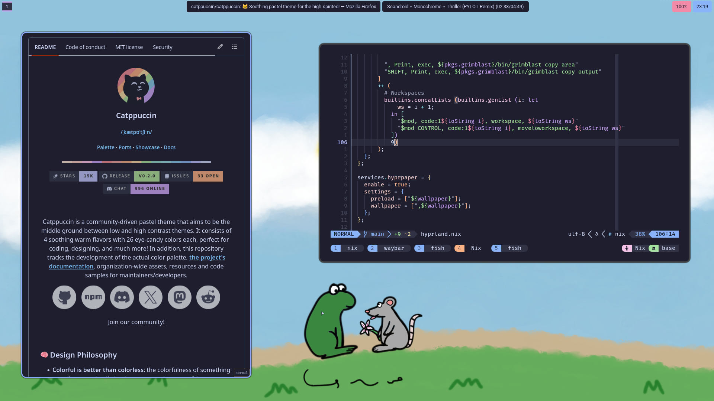
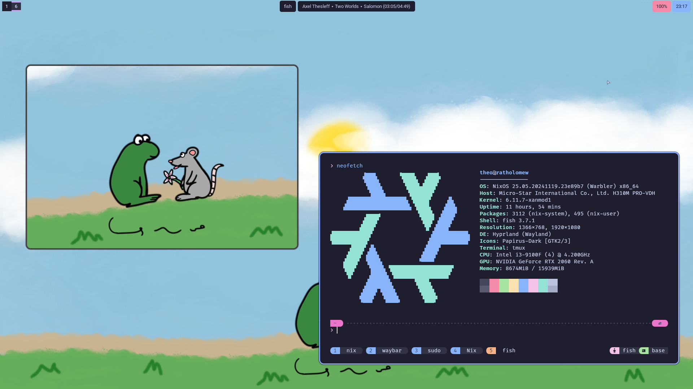
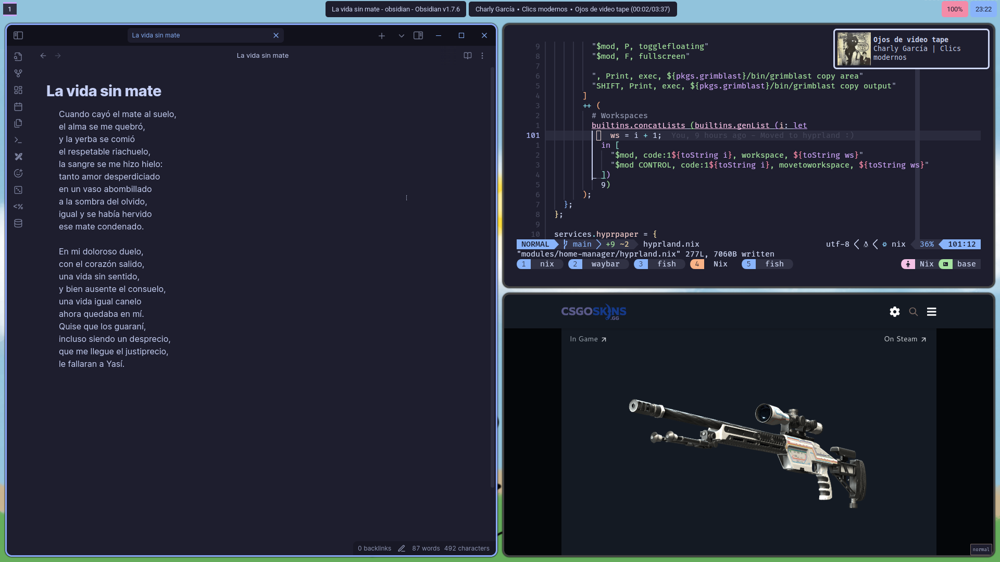

# Frogix

### Me when the linux

A modular NixOS flake: shared modules in `modules/`, machines in `hosts/`, everything
configured through the `frogix.*` option tree. One line turns the whole suite on, every
piece can be tuned or switched off individually.

> [!NOTE]
> The pictures below are way out of date.

#### Features

- NixOS 26.11 (unstable) on flakes
- home-manager for everything user-side
- Niri compositor with a pywal-driven dynamic rice (light + dark mode)
- Fish shell + tmux workflow
- Steam/gaming stack, music production stack, RomM game library
- Declarative secrets via sops-nix





#### Quick start

After doing the [normal installation](https://nixos.org/manual/nixos/stable/#sec-installation):

```bash
git clone https://github.com/thesmallteaboi/frogix && cd frogix
mkdir -p hosts/mymachine   # see docs/getting-started.md
nixos-rebuild switch --flake .#mymachine
```

or try it in a VM first, no install:

```bash
nixos-rebuild build-vm --flake .#vm
./result/bin/run-frogix-vm-vm
```

#### Documentation

| page                                               | contents                                                  |
|----------------------------------------------------|-----------------------------------------------------------|
| [docs/getting-started.md](docs/getting-started.md) | installing frogix on a new machine, step by step          |
| [docs/hosts.md](docs/hosts.md)                     | host directory anatomy: ratholomew and the vm as examples |
| [docs/options.md](docs/options.md)                 | the full `frogix.*` option reference                      |
| [docs/architecture.md](docs/architecture.md)       | how the module system works internally                    |
| [docs/faq.md](docs/faq.md)                         | gotchas and common problems                               |

Licensed MIT.
